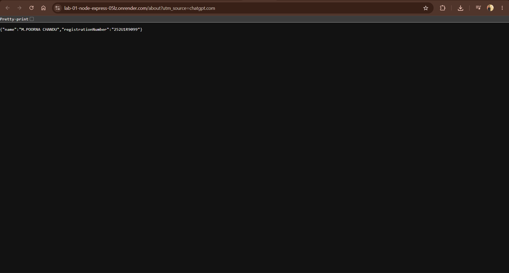
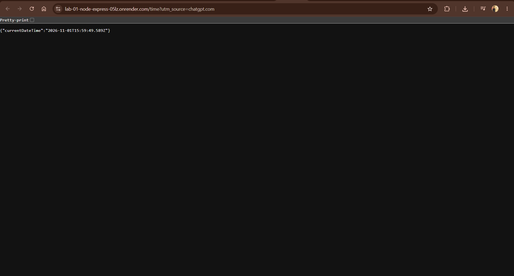

# Lab 01: Node.js and Express Server

**Student:** M.POORNA CHANDU  
**Registration Number:** 252U1R9099  
**Section:** CSE-GEN AI -2B  
**Course:** Backend Development Fundamentals

## Live deployment

The application is deployed on Render and is publicly accessible at:

**Render URL:** [https://lab-01-node-express-05lz.onrender.com](https://lab-01-node-express-05lz.onrender.com)

## Project description

This Lab 1 project demonstrates two separate web servers. `server-http.js` is the basic Node.js server created with `http.createServer`; it returns `Hello`. `server.js` is the Express server used for the required routes and Render deployment. The Express server uses Render's `PORT` environment variable when one is provided, and port 3000 locally.

## Technologies used

- Node.js
- Express.js
- JavaScript
- npm
- Git and GitHub
- Render

## Requirements and installation

Install Node.js 18 or later (npm is included with Node.js), then open a terminal in this `lab-01` folder and run:

```bash
npm install
```

## Run the project

Start the Express server (the command Render uses):

```bash
npm start
```

Start the plain Node.js HTTP server instead:

```bash
npm run start:http
```

Only run one server at a time because both use port 3000 locally. Open `http://localhost:3000` in a browser and stop a server with `Ctrl + C`.

## Test the project

```bash
npm test
npm run test:http
```

`npm test` checks the Express routes. `npm run test:http` checks that the separate basic HTTP server returns `Hello`. Each test temporarily starts its server on port 3101 and then stops it automatically.

## Endpoints

| Method | Path | Description | Expected status | Locally verified status |
| --- | --- | --- | --- | --- |
| GET | `/` | Returns a welcome text message. | 200 OK | 200 OK |
| GET | `/about` | Returns the student's name and section as JSON. | 200 OK | 200 OK |
| GET | `/time` | Returns the server's current date and time in ISO format. | 200 OK | 200 OK |
| GET | `/invalid` | Demonstrates the response for an unknown route. | 404 Not Found | 404 Not Found |

```text
http://localhost:3000/
http://localhost:3000/about
http://localhost:3000/time
http://localhost:3000/invalid
```

## Project files

| File | Purpose |
| --- | --- |
| `server.js` | Express server used for local development and Render deployment. |
| `server-http.js` | Basic server made only with Node.js's `http` module. |
| `test-routes.js` | Checks the expected route status codes automatically. |
| `package.json` | Project information, dependency list, and npm commands. |
| `package-lock.json` | Records exact installed dependency versions for repeatable installs. |
| `.gitignore` | Keeps `node_modules`, `.env`, logs, and local editor files out of Git. |

## `package.json` and `node_modules` explained

`package.json` is the project instruction file. These are the fields used in this project:

| Field | Simple explanation |
| --- | --- |
| `name` | The package name for this Lab 1 project. |
| `version` | The current project version (`1.0.0`). |
| `description` | A short explanation of the project. |
| `main` | The primary JavaScript file (`server.js`). |
| `scripts` | Short commands run with npm: `start` runs Express, `start:http` runs the basic HTTP server, and the two test scripts run route checks. |
| `keywords` | Search words that describe the project. |
| `author` | A place for author information; it is currently blank in the package file. |
| `license` | The selected license label (`ISC`). |
| `type` | `commonjs` allows `require()` syntax in the JavaScript files. |
| `engines` | States that Node.js 18 or later is required. |
| `dependencies` | Packages needed at runtime; this project needs Express. |

`node_modules` is the folder npm downloads after `npm install`. Express is installed at `node_modules/express`. It is needed locally, but must **not** be uploaded to GitHub because `npm install` recreates it from `package.json` and `package-lock.json`.

`package-lock.json` records the exact versions npm installed, so the same dependency tree can be installed again.

## Environment variables

No custom secrets or required `.env` values are used in this lab. `PORT` is optional: Render supplies it during deployment, while both servers use `3000` when it is not set locally. `.env` remains ignored by Git in case a future lab needs private settings.

## Render deployment settings

When this folder is inside a course repository beside `lab-02` through `lab-10`, use these settings:

| Render field | Value |
| --- | --- |
| Service type | Web Service |
| Runtime | Node |
| Root Directory | `lab-01` |
| Build Command | `npm install` |
| Start Command | `npm start` |
| Plan | Free, if it is available in your Render account and region |

For a standalone repository, leave **Root Directory** empty.

## Screenshots

The image links below are correct relative paths. Because the Express `/` and `/about` responses were corrected during the final audit, **recapture `home.png` and `about.png` after the next Render deployment**. The existing `time.png` and `not-found.png` still match their current route outputs.

### Home Route


### About Route



### Time Route



### 404 Not Found Route


## Problems faced and solutions

| Problem | Solution |
| --- | --- |
| Port 3000 is already in use. | Stop the other server with `Ctrl + C`, or use a different `PORT` value. |
| `Cannot find module 'express'` appears. | Run `npm install` in the `lab-01` folder. |
| Render cannot start the app. | Check that the Root Directory, build command, and start command match the table above. |

## GitHub submission notes

This lab belongs in the course repository as the `lab-01` folder. Do not commit `node_modules` or `.env`; `.gitignore` already excludes both.
