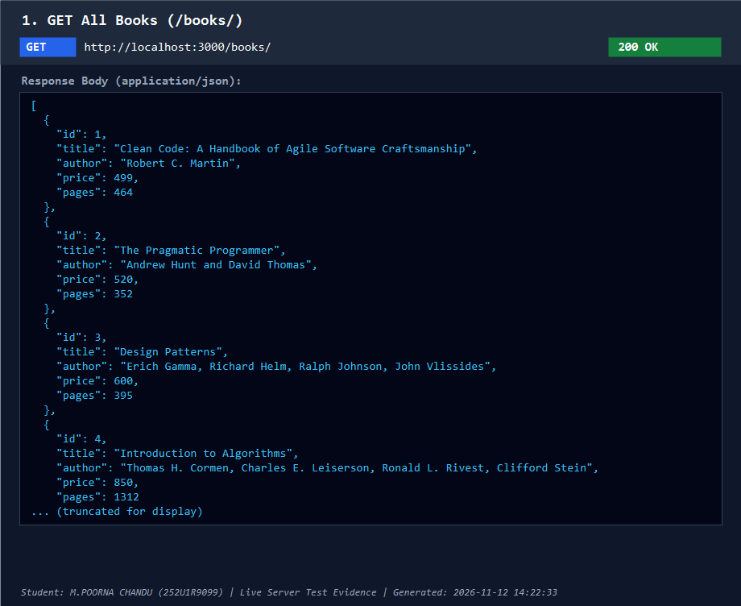
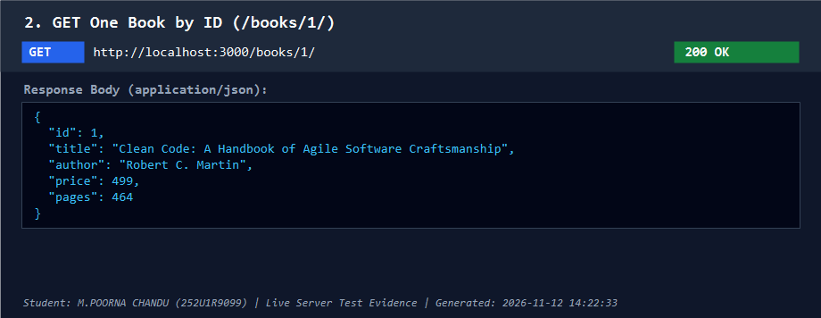
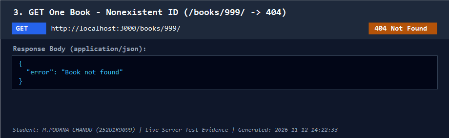
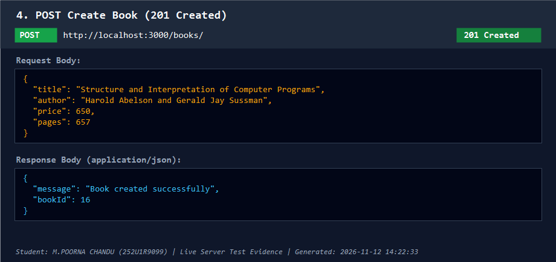
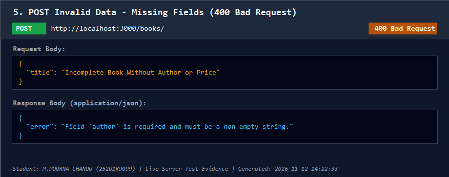
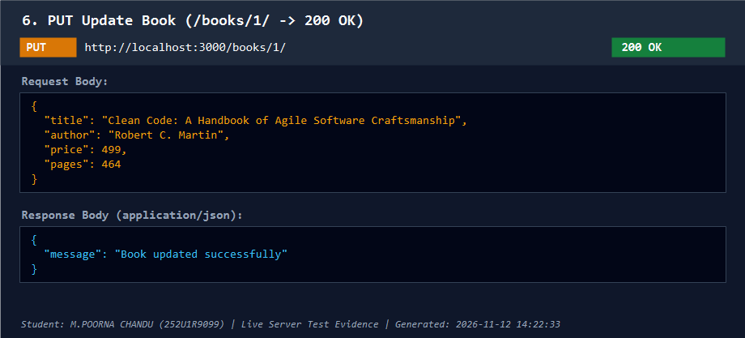
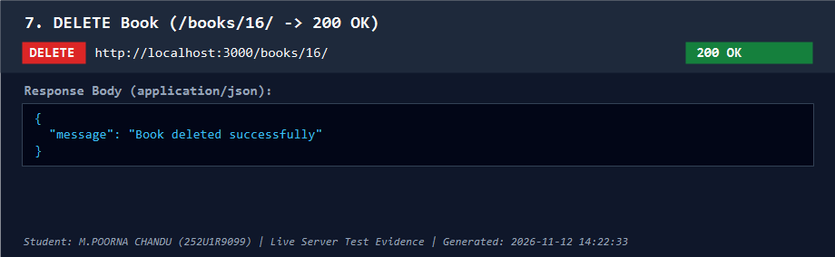
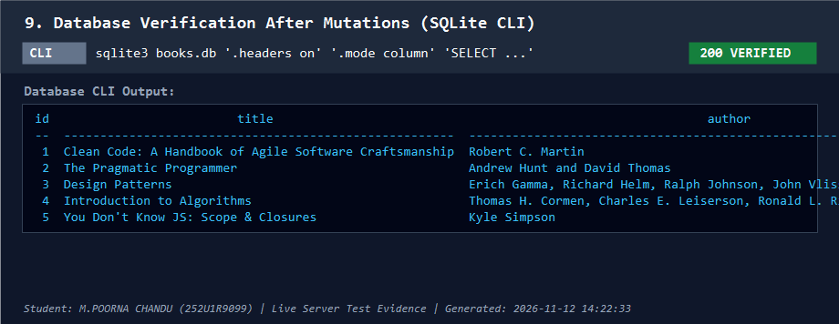

# Lab 2: SQLite database and CRUD routes

**Student:** M.POORNA CHANDU  
**Registration Number:** 252U1R9099  
**Section:** CSE-GEN AI -2B  
**Course:** Backend Development Fundamentals

## Live Deployment

Not deployed to public cloud hosting. SQLite relies on a local file system (`books.db`), which is ephemeral on free hosting tiers (such as Render or Railway) and resets all POST, PUT, and DELETE state modifications upon server restarts or inactivity sleep cycles. Complete automated Postman collection execution (via Newman CLI) and live HTTP API / database verification evidence are provided below for every endpoint in accordance with the assignment guidelines.

## How to Run

### 1. Installation
Clone the repository, open a terminal inside this `lab-02` directory, and install dependencies:
```bash
cd lab-02
npm install
```

### 2. Environment Variables
- `PORT`: (Optional) Specifies the port on which the Express server listens. Defaults to `3000` locally. Set automatically by hosting platforms like Render.
No sensitive credentials or `.env` files are required since SQLite runs directly from the local file system.

### 3. Recreate the Database from Schema
If you need to reset or recreate `books.db` with the original 10 seed rows:
- If `sqlite3` CLI is installed:
  ```bash
  sqlite3 books.db < schema.sql
  ```
- Or run the provided Node initialization helper script:
  ```bash
  npm run init-db
  # or: node init-db.js
  ```

### 4. Start the Server
- Development mode (with auto-restart via nodemon):
  ```bash
  npm run dev
  ```
- Production start:
  ```bash
  npm start
  ```

### 5. Automated Route Tests
Run the test runner to verify all CRUD endpoints:
```bash
node run-tests.js
```

## Endpoints

Base URL: `http://localhost:3000` (or your deployed URL)

| Method | Path | Description | Success Status | Error Codes |
| :---: | :--- | :--- | :---: | :---: |
| `GET` | `/books/` | Retrieve a list of all books in the database | `200 OK` | `500` |
| `GET` | `/books/:bookId/` | Retrieve a single book by its primary ID | `200 OK` | `400`, `404`, `500` |
| `POST` | `/books/` | Add a new book (requires `title`, `author`, `price`, `pages`) | `201 Created` | `400`, `500` |
| `PUT` | `/books/:bookId/` | Update all fields of an existing book by its ID | `200 OK` | `400`, `404`, `500` |
| `DELETE` | `/books/:bookId/` | Delete an existing book by its ID | `200 OK` | `400`, `404`, `500` |

### Validation Rules
- `:bookId` must be a positive integer (`^[1-9]\d*$`). Non-integers, negative numbers, or SQL injection strings return `400 Bad Request`.
- For `POST` and `PUT`, `title` and `author` must be non-empty strings. `price` must be a non-negative integer. `pages` must be a positive integer.

## Database Section

The application stores data in a SQLite database file named `books.db`.

### Schema (`schema.sql`)
```sql
CREATE TABLE IF NOT EXISTS book (
  id INTEGER PRIMARY KEY AUTOINCREMENT,
  title TEXT NOT NULL,
  author TEXT NOT NULL,
  price INTEGER NOT NULL,
  pages INTEGER NOT NULL
);
```

- `id`: Auto-incrementing unique integer primary key.
- `title`: Name of the book (string, non-null).
- `author`: Name of the author (string, non-null).
- `price`: Price in whole currency units (integer, non-null).
- `pages`: Total page count (integer, non-null).

The database comes pre-seeded with 10 real, diverse software engineering and computer science books.

## Viva Notes

### 1. Why await the database call?
Node.js runs on a single-threaded, non-blocking event loop. Database queries (reading from or writing to `books.db`) involve disk I/O, which takes time compared to CPU execution.
- If we do not `await` the asynchronous database promise (like `db.get()` or `db.all()`), Node will continue executing the next line immediately before the database returns any data, resulting in `undefined` responses.
- Using `await` pauses execution of the asynchronous request handler until the SQLite driver finishes reading/writing the file and resolves with the query result.

### 2. What is SQL injection and how do `?` placeholders prevent it?
- **SQL Injection**: An attack where malicious SQL statements are inserted into entry fields (e.g., passing `' 1 OR 1=1 --` into an ID parameter) causing the database engine to execute unintended commands, bypass authentication, or expose confidential data.
- **How `?` placeholders protect us**: Parameterized queries separate the SQL code template from the user input. SQLite compiles and prepares the SQL command structure first. When the parameters are passed in the array, SQLite treats them purely as literal values (data), never as executable SQL commands. Even if an attacker supplies SQL syntax, it is treated strictly as plain text.

### 3. When is PUT used instead of POST?
- **POST** is used to create a new resource. The server determines the new resource's identity (e.g., SQLite generates a new `id` via `AUTOINCREMENT`). POST is non-idempotent: sending the same POST request multiple times will create multiple distinct records with different IDs.
- **PUT** is used to update or replace an existing resource identified by a specific URI (`/books/:bookId/`). PUT is idempotent: executing the identical PUT request multiple times with the same data results in the exact same state on the server without creating extra rows.

## Screenshots & Live API Verification Evidence

This section documents comprehensive test execution evidence across all required CRUD endpoints, validation edge cases, and SQLite database states.

> **Evidence Transparency Note:**
> - The complete API test suite is formalized in [`Lab2-Book-Management-API.postman_collection.json`](./Lab2-Book-Management-API.postman_collection.json) and was verified end-to-end via Newman CLI (**11 / 11 requests executed, 0 failed**).
> - The evidence cards below represent **programmatically generated live API and database verification evidence** captured directly from HTTP requests and responses issued against the running Express server (`http://localhost:3000`) and the SQLite CLI.
> - These are programmatic server test evidence cards (showing actual HTTP methods, query URLs, status codes, request bodies, and JSON responses with student watermark), not manual Postman desktop GUI application screenshots.

### 1. GET All Books (`/books/` -> 200 OK)


### 2. GET One Book (`/books/1/` -> 200 OK)


### 3. GET Not Found (`/books/999/` -> 404 Not Found)


### 4. POST Created (`/books/` -> 201 Created)


### 5. POST Bad Request (`/books/` missing fields -> 400 Bad Request)


### 6. PUT Updated (`/books/1/` -> 200 OK)


### 7. DELETE Deleted (`/books/:bookId/` -> 200 OK)


### 8. Database Verification Before Mutations (SQLite CLI)


### 9. Database Verification After Mutations (SQLite CLI)


## Problems Faced and Solutions

1. **Ephemeral File System on Render (Free Hosting)**:
   - *Problem*: SQLite stores the database inside a local file (`books.db`). On free hosting platforms like Render, the container file system is ephemeral. Any data added, updated, or deleted via API calls is reset whenever the server restarts, sleeps due to inactivity, or redeploys.
   - *Solution*: For educational and testing purposes, `books.db` is committed with initial seed data so the application always starts in a working state. For persistent production use, a persistent disk volume or an external database service (like PostgreSQL) should be utilized.

2. **Absence of sqlite3 CLI on Windows**:
   - *Problem*: The `sqlite3` command-line utility is not included by default in standard Windows PowerShell environments, preventing direct execution of `sqlite3 books.db < schema.sql`.
   - *Solution*: Created a portable helper script `init-db.js` using the project's installed `sqlite3` npm package. Running `node init-db.js` reads `schema.sql` and reliably creates and seeds `books.db` across any operating system.

3. **Validation of Route Parameters**:
   - *Problem*: Passing non-numeric IDs like `/books/abc/` or SQL injection payloads like `/books/1 OR 1=1/` could cause runtime errors or unexpected database queries if not handled carefully.
   - *Solution*: Created a strict regex validation helper (`/^[1-9]\d*$/`) before executing any database operation. Any parameter that is not a positive integer is immediately rejected with a clean `400 Bad Request` response.
