# Lab 3: REST API, query parameters, validation, debugging

**Student:** M.POORNA CHANDU  
**Registration Number:** 252U1R9099  
**Section:** CSE-GEN AI -2B  
**Course:** Backend Development Fundamentals  
**Faculty:** Joel Prashanth D  

---

## Live Deployment

Not deployed to public cloud hosting. SQLite relies on a local file system (`books.db`), which is ephemeral on free hosting tiers (such as Render or Railway) and resets all POST, PUT, and DELETE state modifications upon server restarts or inactivity sleep cycles. Complete automated Postman collection execution (via Newman CLI) and live HTTP API / database verification evidence are documented below for every endpoint in accordance with the assignment guidelines.

---

## How to Run

### 1. Installation
Open a PowerShell terminal, navigate into the `lab-03` directory, and install dependencies:
```bash
cd lab-03
npm install
```
*(On Windows systems where script execution is restricted, use `npm.cmd install`)*

### 2. Environment Variables
- `PORT`: (Optional) Specifies the port on which the Express server listens. Defaults to `3000` locally.
- No sensitive `.env` credentials are required since SQLite runs directly on the local file system.

### 3. Initialize or Reset Database
To initialize `books.db` with the 10 seed software engineering books:
```bash
node init-db.js
```
*(Automatically creates a safe backup copy `books.db.backup` before any reset operation).*

### 4. Start the Server
- Development mode with auto-restart on file changes:
  ```bash
  npm.cmd run dev
  ```
- Standard production start:
  ```bash
  npm.cmd start
  ```

### 5. Automated Route Tests
Run the comprehensive automated test suite covering all 26 query parameter, CRUD, and validation scenarios:
```bash
node run-tests.js
```

---

## Endpoints Table

Base URL: `http://localhost:3000`

| Method | Endpoint Path | Query Parameters | Description | Success Status | Error Codes |
| :---: | :--- | :--- | :--- | :---: | :---: |
| `GET` | `/` | None | API root information and student metadata | `200 OK` | `500` |
| `GET` | `/books/` | `search_q`, `order_by`, `order`, `limit`, `offset`, `min_price`, `max_price` | Retrieve books with partial title search, price range filtering, whitelisted column sorting, and pagination | `200 OK` | `400`, `500` |
| `GET` | `/books/:bookId/` | None | Retrieve a single book by its primary ID | `200 OK` | `400`, `404`, `500` |
| `POST` | `/books/` | None | Create a new book record (requires `title`, `author`, `price`, `pages`) | `201 Created` | `400`, `500` |
| `PUT` | `/books/:bookId/` | None | Update all fields of an existing book by its primary ID | `200 OK` | `400`, `404`, `500` |
| `DELETE`| `/books/:bookId/` | None | Delete an existing book by its primary ID | `200 OK` | `400`, `404`, `500` |

---

## Query Parameters Guide (`GET /books/`)

| Parameter | Type | Default Value | Description & Constraints | Example |
| :--- | :---: | :---: | :--- | :--- |
| `search_q` | String | `""` | Case-insensitive partial title match using SQL `LIKE %search_q%` | `?search_q=Clean` |
| `order_by` | String | `"id"` | Column to sort by. Whitelisted to: `id`, `title`, `author`, `price`, `pages` | `?order_by=price` |
| `order` | String | `"ASC"` | Sort direction. Whitelisted to: `ASC` or `DESC` | `?order=DESC` |
| `limit` | Integer | `10` | Maximum number of records to return (must be positive) | `?limit=5` |
| `offset` | Integer | `0` | Number of initial records to skip for pagination (non-negative) | `?offset=3` |
| `min_price`| Number | None | Filter books with price greater than or equal to this value | `?min_price=400` |
| `max_price`| Number | None | Filter books with price less than or equal to this value | `?max_price=700` |

> **Combined Example:**
> `GET /books/?search_q=Patterns&min_price=500&max_price=650&order_by=price&order=ASC&limit=5`

---

## Validation & Error Handling

- **Consistent Error Response Format:** Every error returned by the server follows the standard JSON shape:
  ```json
  {
    "message": "Error description here"
  }
  ```
- **Strict Input Validation Rules:**
  - `:bookId` must be a positive integer (`^[1-9]\d*$`). Values like `/books/abc/` or SQL injection payloads return `400 Bad Request`.
  - For `POST` and `PUT`, `title` and `author` must be non-empty strings. `price` must be a non-negative number. `pages` must be a positive integer.
  - If `min_price` is greater than `max_price`, the API returns `400 Bad Request` with `"min_price cannot be greater than max_price"`.

---

## Viva Questions & Answers

### 1. Query parameter vs path parameter?
- **Path Parameter (e.g. `/books/:bookId/`):** Identifies a specific, distinct resource on the server. The identifier is an essential part of the resource's URL path.
- **Query Parameter (e.g. `/books/?order_by=price&limit=5`):** Appears after the `?` in the URL and is used to sort, filter, paginate, or search a collection of resources without altering the identity of the base resource.

### 2. What does stateless mean in REST?
- **Statelessness** means that each HTTP request from a client to the server must contain all the information necessary for the server to understand and process the request.
- The server does not store any client session state between requests. Every request is completely independent. If request A succeeds, request B does not rely on memory from request A.

### 3. Which status code for bad input vs a missing record?
- **Bad Input (`400 Bad Request`):** Used when the client sends malformed syntax, invalid data types (e.g., string for price), missing required fields, or unparseable query parameters. The client must fix their payload before retrying.
- **Missing Record (`404 Not Found`):** Used when the request syntax and parameters are valid, but the requested resource (e.g., book with ID 999) does not exist in the database.

---

## Debugging Exercise: 4 Common Faculty Bug Scenarios

### Bug 1: Port Conflict (`EADDRINUSE`)
- **Cause:** Another process (such as a previous node instance or another background service) is already listening on the requested port (e.g., `3000`).
- **Fix:** In code, listen for the `'error'` event on the server instance:
  ```javascript
  server.on("error", (err) => {
    if (err.code === "EADDRINUSE") {
      console.error(`Port ${PORT} is already in use. Terminate the existing process or choose another PORT.`);
    }
  });
  ```
  In Windows PowerShell, find and terminate the blocking process:
  ```powershell
  Get-NetTCPConnection -LocalPort 3000 | Select-Object OwningProcess
  Stop-Process -Id <OwningProcessId> -Force
  ```

### Bug 2: Wrong Import Path
- **Cause:** Providing an incorrect relative path when importing modules (e.g., `require("./books.db")` instead of `path.join(__dirname, "books.db")` or typing `require("../server")` when in the same folder).
- **Fix:** Use Node's built-in `path.join(__dirname, "filename")` to construct absolute paths reliably across different working directories and operating systems.

### Bug 3: Table-Name Typo (`no such table`)
- **Cause:** Misspelling the SQL table name in the query (e.g., `SELECT * FROM books` instead of `SELECT * FROM book`). SQLite throws a runtime error `SQLITE_ERROR: no such table: books`.
- **Fix:** Ensure the SQL query precisely matches the table definition declared in `schema.sql`: `CREATE TABLE IF NOT EXISTS book (...)`. Check case-sensitivity and pluralization.

### Bug 4: Missing `await` on Database Call
- **Cause:** Calling asynchronous SQLite methods like `db.all()` or `db.get()` without the `await` keyword inside an `async` request handler.
- **Symptom:** The function continues immediately and returns an empty or pending Promise object `[object Promise]` to the client before SQLite has finished reading from disk.
- **Fix:** Prepend `await` to every database I/O call:
  ```javascript
  const books = await db.all("SELECT * FROM book");
  ```

---

## Screenshots & Live API Verification Evidence

This section documents comprehensive test execution evidence across all required REST API endpoints, query parameter variations, error handling edge cases, and SQLite database states.

> **Evidence Transparency Note:**
> - The complete API test suite is formalized in [`Lab3-REST-API.postman_collection.json`](./Lab3-REST-API.postman_collection.json) and was verified end-to-end via Newman CLI (**15 / 15 requests executed, 0 failed**).
> - The 12 evidence cards below represent **programmatically generated live API and database verification evidence** captured directly from HTTP requests and responses issued against the running Express server (`http://localhost:3000`) and the SQLite CLI.
> - These are programmatic server test evidence cards (showing actual HTTP methods, query URLs, status codes, request bodies, and JSON responses with student watermark), not manual Postman desktop GUI application screenshots.

### 1. GET All Books (Default: limit=10, offset=0, order=id ASC)
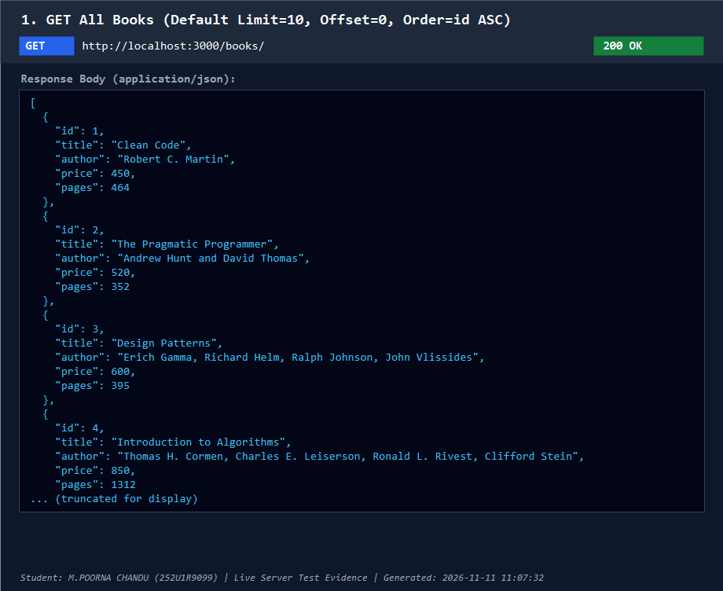

### 2. GET Search by Title (`?search_q=Clean`)
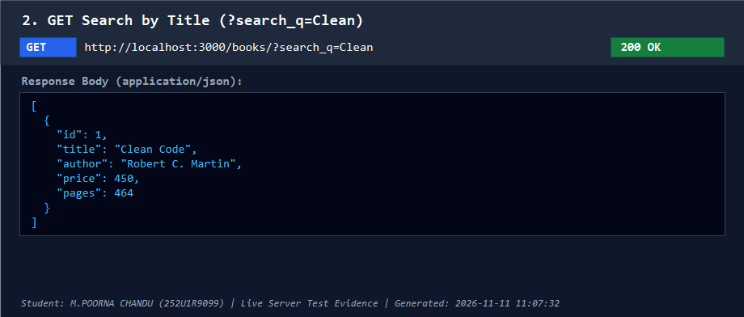

### 3. GET Sort by Price Descending (`?order_by=price&order=DESC`)
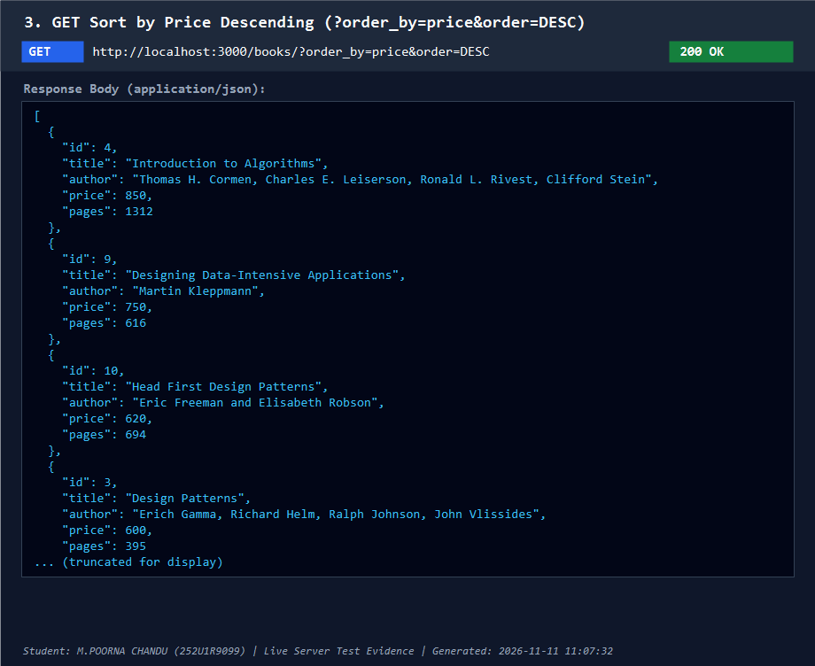

### 4. GET Price Range Filter (`?min_price=500&max_price=700`)
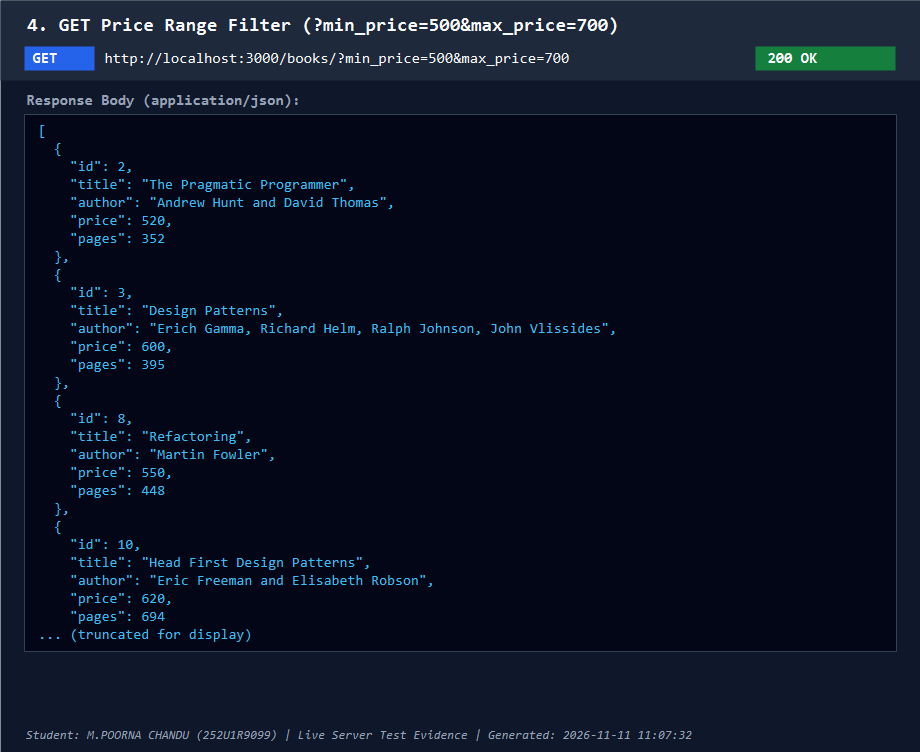

### 5. GET Pagination (`?limit=3&offset=0`)
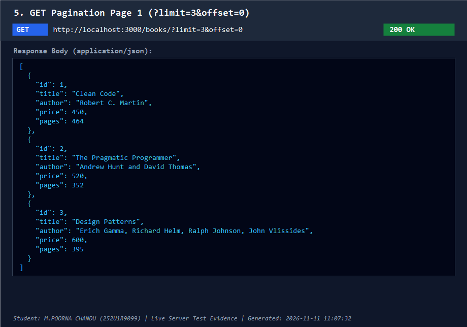

### 6. GET Single Book by ID (`/books/1/`)
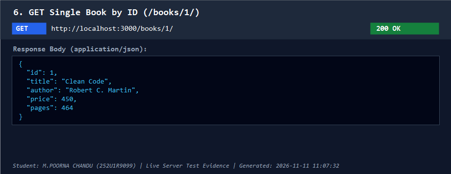

### 7. GET Nonexistent Book (`/books/999/` -> 404 Not Found)
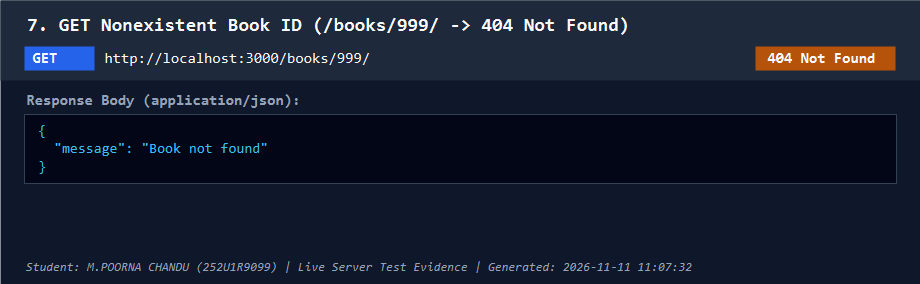

### 8. POST Create Book (`201 Created`)
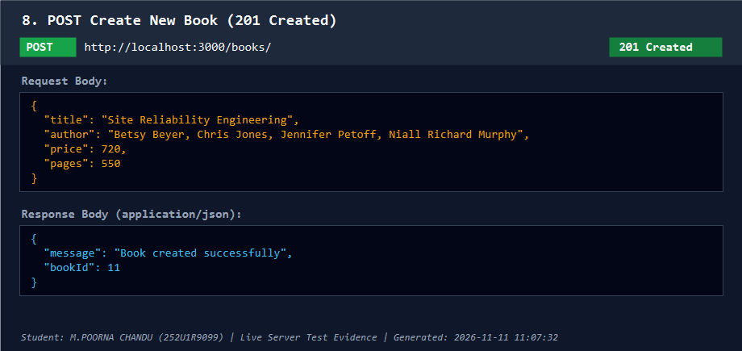

### 9. POST Validation Error - Missing Title (`400 Bad Request`)
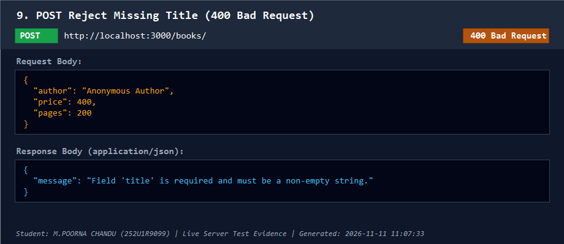

### 10. PUT Update Book (`200 OK`)
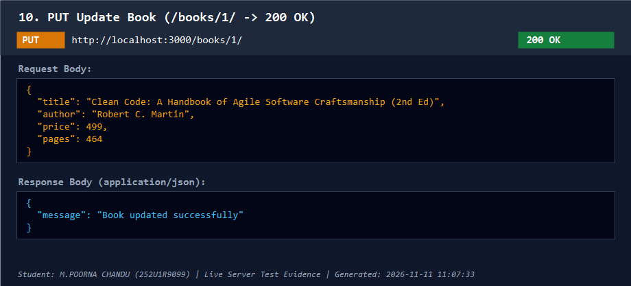

### 11. DELETE Book (`200 OK`)
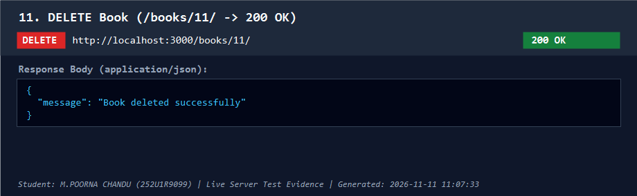

### 12. SQLite CLI Database Verification (Table 'book')
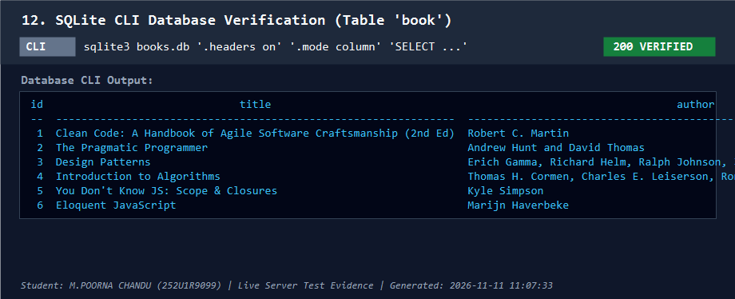


